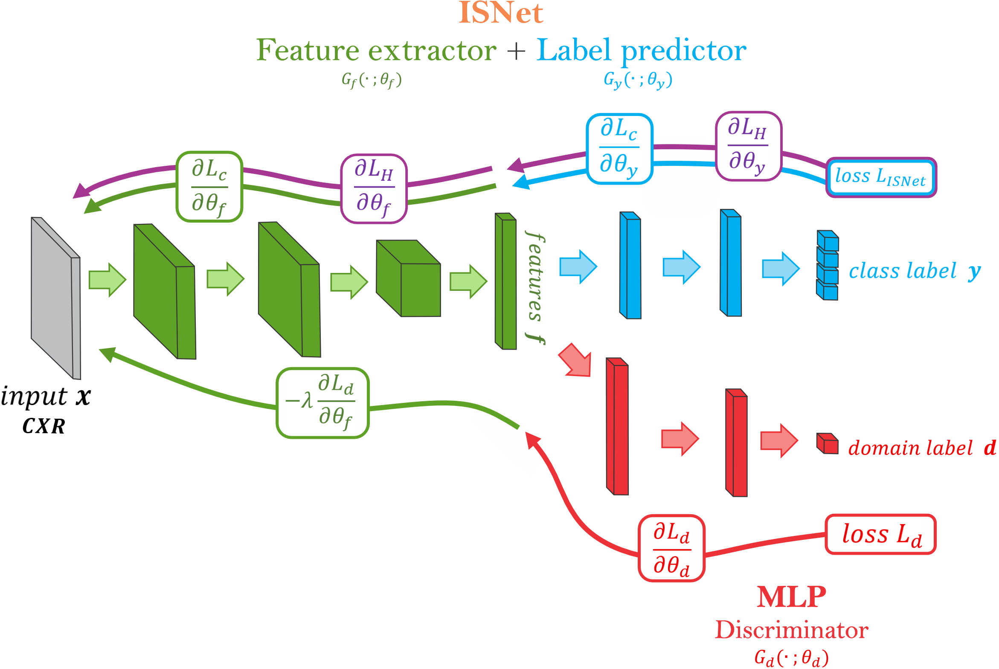

# ISNetDANN

**ISNetDANN** is a penalization-based method that combines the **DANN** (*Domain-Adversarial Neural Networks*) and **ISNet** (*Implicit Segmentation Network*) approaches to mitigate demographic and background shortcuts in chest X-ray classification models.

- **DANN** encourages the model to learn demographic-invariant representations through an adversarial optimization.
- **ISNet** uses LRP relevance maps to penalize the model for basing its decisions on regions outside the anatomical areas of interest (lungs and heart).
- **ISNetDANN** uses an ISNet network as the feed-forward network (feature extractor and label predictor) inside the DANN adversarial scheme, while a fully connected multi-layer perceptron (MLP) acts as the adversarial domain classifier. Therefore, combining both penalizations in a single loss and targeting both demographic and background shortcuts.

The repository contains the code for preprocessing, training, evaluation (performance, fairness, and linear evaluation of representations) and hyperparameter sweeps, along with the ERM, ISNet, DANN and ISNetDANN algorithms.

---

## Table of contents

1. [How ISNetDANN works](#how-isnetdann-works)
2. [Repository structure](#repository-structure)
3. [Requirements and installation](#requirements-and-installation)
4. [Data](#data)
5. [Training](#training)
6. [Evaluation](#evaluation)
7. [Hyperparameter sweeps](#hyperparameter-sweeps)
8. [Main hyperparameters](#main-hyperparameters)
9. [Output files](#output-files)
10. [Reproducibility](#reproducibility)
11. [Citation](#citation)

---

## How ISNetDANN works

For each minibatch `(image, label y, attribute a, mask)`:

1. A **feature extractor** (the DenseNet121 backbone of the ISNet network) produces the feature vector `z`.
2. A **discriminator** (MLP) tries to predict the demographic attribute `a` from `z`.
3. Training **alternates** discriminator and generator steps (`d_steps_per_g_step`).
4. In the **generator** step the following loss is minimized:

```
gen_loss   = isnet_loss − λ · disc_loss
isnet_loss = (1 − P) · cLoss + P · hLoss
```

   where:
   - `cLoss`: classification loss.
   - `hLoss`: relevance-map (LRP) loss computed using the anatomical masks.
   - `λ` (`lambda`): weight of the adversarial loss.
   - `P`: weight of the ISNet penalty. It grows linearly from **0.05 to 0.4** over the first **15,000 steps** and then stays constant.

The masks (left lung, right lung and heart) are decoded from RLE, combined and dilated (including a smooth downward expansion at the lung bases) before being used in the penalty.

## ISNetDANN Architecture



---

## Repository structure

```
ISNetDANN/
├── train.py                  # Train a single model
├── eval.py                   # Evaluate a trained model
├── experiments.py            # Experiment grid definitions (training and evaluation)
├── sweep_grid.py             # Sweep launcher / job management
├── command_launchers.py      # Launchers: local, dummy, multi_gpu, slurm
├── hparams_registry.py       # Hyperparameter registry per algorithm
├── visualize_chest_x_ray.ipynb  # Chest X-ray visualization notebook
├── model_training/           # Datasets, algorithms, networks, optimizers, early stopping,
│                             # dataloaders, data augmentation and LRP module (ISNetFlexTorch)
├── model_eval/               # eval_helper.py (metrics) and lin_eval.py (linear evaluation)
├── models/                   # ERM and ISNetDANN evaluation (results obtained from the study)
├── df_construction/          # Construction of the metadata dataframes
└── LRP_FLEX_comparisson/     # LRP relevance heatmaps visualization and comparison
```

---

## Requirements and installation

The following are required:

- Python 3.8+
- PyTorch and torchvision (with CUDA for GPU training)
- numpy, pandas, Pillow, matplotlib, tqdm
- opencv-python (`cv2`)
- scikit-learn
- netcal (ECE computation)
- transformers

```bash
git clone https://github.com/lchanchi342/ISNetDANN.git
cd ISNetDANN

python -m venv venv
source venv/bin/activate

# Install PyTorch matching your CUDA version: https://pytorch.org/get-started/locally/
pip install torch torchvision
pip install numpy pandas pillow matplotlib tqdm opencv-python scikit-learn netcal transformers
```

> The original experiments were run on an NVIDIA RTX A6000 GPU.

---

## Data

The code uses the dataframes constructed from the **MIMIC-CXR-JPG**, **MIMIC-IV**, and **CheXmask** datasets. 

> Access to MIMIC requires credentials and approval from PhysioNet. This repository does not distribute the data.

> The MIMIC-CXR-JPG is available at https://physionet.org/content/mimic-cxr-jpg/2.1.0/ CheXmask Database is available at https://physionet.org/content/chexmask-cxr-segmentation-data/0.4/ Finally, demographic labels are available in the MIMIC-IV Dataset https://physionet.org/content/mimiciv/2.2/

The `MIMIC` class reads a **metadata CSV** (passed with `--data_dir`) containing:

| Column | Description |
|---|---|
| `path` | **Absolute** path to the image (the root is fixed to `/`). |
| `split` | Partition: `0` = train, `1` = validation, `2` = test. |
| `No Finding`, `Pleural Effusion`, `Cardiomegaly`, `Pneumothorax` | Binary labels for the prediction tasks. |
| `sex`, `race`, `sex_race`, `age` | Demographic attributes encoded as integers. |
| `Left Lung`, `Right Lung`, `Heart` | Masks in RLE format. **Only** with `--use_masks`. |
| `Height`, `Width` | Original image dimensions. **Only** with `--use_masks`. |

- **Tasks** (`--task`): `No Finding`, `Pleural Effusion`, `Cardiomegaly`, `Pneumothorax`.
- **Attributes** (`--attr`): `sex`, `race`, `sex_race`, `age`.
- Images are resized to 256×256 and normalized with MIMIC's mean and standard deviation.
- `ISNetAlgorithm` and `ISNetDANN` require masks (`--use_masks`); ERM, DANN and CDANN do not.


---

## Training

There are two ways to run the training process: by running individual experiments and explicitly specifying the required training parameters, or by executing complete experiment grids defined in the `experiments.py` file.

The main arguments and hyperparameters can be specified either when running an individual experiment or in the `experiments.py` file.


### `train.py` arguments

| Argument | Default | Description |
|---|---|---|
| `--store_name` | `debug` | Name of the output subfolder inside `--output_dir`. |
| `--dataset` | `MIMIC` | Dataset (currently only one). |
| `--task` | `No Finding` | Pathology to predict. |
| `--attr` | `sex` | Demographic attribute. |
| `--group_def` | `group` | Group definition: `group` or `label`. |
| `--algorithm` | `ERM` | `ERM`, `ISNetAlgorithm`, `DANN`, `CDANN`, `ISNetDANN`. |
| `--output_dir` | `output` | Root output folder. |
| `--data_dir` | `data` | Path to the metadata CSV. |
| `--hparams` | – | Hyperparameter dictionary as JSON (overrides defaults). |
| `--hparams_seed` | `0` | `0` = default hyperparameters; any other value = random hyperparameters. |
| `--seed` | `0` | Seed for everything else. |
| `--epochs` | `None` | Number of epochs. **Must be provided.** |
| `--use_es` | `False` | Enables early stopping. |
| `--es_metric` | `overall:AUROC` | Early-stopping metric (`group:metric`). |
| `--es_patience` | `5` | Checkpoints without improvement before stopping. |
| `--min_delta` | `0.0` | Minimum improvement to reset the counter. |
| `--resume`, `-r` | – | Path to a checkpoint to resume from. |
| `--checkpoint_freq` | 1 epoch | Checkpoint/evaluation frequency, in steps. |
| `--skip_model_save` | `False` | Do not save intermediate checkpoints. |
| `--debug` | `False` | Disables saving `out.txt`/`err.txt` and periodic evaluation. |
| `--image_arch` | `densenet121` | Architecture (DenseNet121 only). |
| `--aug` | `basic2` | Data augmentation: `none`, `basic`, `basic2`, `auto_aug`, `rand_aug`, `trivial_aug`, `augmix`. |
| `--use_masks` | `False` | Load and use the anatomical masks. |
| `--heat` | `False` | Enables heatmap analysis. |
| `--tuneCut` | `False` | Computes ISNet's `cut`/`cut2` values before training. |
| `--only_tune_cut` | `False` | Exit after computing the cuts (saves `cuts.pkl`). |
| `--loadCuts` | `False` | Reserved for loading previously computed cuts. |


### Available algorithms

| Algorithm | Description |
|---|---|
| `ERM` | Empirical risk minimization (standard baseline). |
| `ISNetAlgorithm` | ISNet only (LRP penalty with masks). |
| `DANN` | Unconditional DANN. |
| `CDANN` | Class-conditional DANN with class balancing. |
| `ISNetDANN` | Proposed method: DANN with ISNet as the generator. |

### Tuning the cut values (`cut` / `cut2`)

ISNet needs a natural range for the total relevance of the LRP maps. By default ISNetDANN uses `cut=1` and `cut2=25` (suggested values for DenseNet). To compute them with your own data:

```bash
python -m train ... --algorithm ISNetDANN --use_masks --tuneCut --only_tune_cut
```

This trains for `tuneCutEpochs` epochs, saves the cuts to `cuts.pkl` and exits.


### Individual experiments:

### Example: ISNetDANN with attribute `sex`

```bash
python -m train \
    --store_name isnetdann_sex \
    --dataset MIMIC \
    --image_arch densenet121 \
    --task "No Finding" \
    --attr sex \
    --algorithm ISNetDANN \
    --group_def group \
    --data_dir /path/to/image_mask_df.csv \
    --output_dir output \
    --epochs 10 \
    --checkpoint_freq 1000 \  
    --use_masks \
    --use_es --es_metric overall:AUROC --es_patience 5 --min_delta 0.001 \
    --hparams_seed 0 \
    --seed 0 \
    --skip_model_save 
```

### Example: ERM baseline (no masks)

```bash
python -m train \
    --store_name erm_sex \
    --dataset MIMIC \
    --task "No Finding" \
    --attr sex \
    --algorithm ERM \
    --group_def group \
    --image_arch densenet121 \
    --data_dir /path/to/image_df.csv \
    --epochs 10 \
    --checkpoint_freq 1000 \
    --use_es --es_metric overall:AUROC --es_patience 5 --min_delta 0.001 \
    --hparams_seed 0 \
    --seed 0 \
    --skip_model_save 
    
```

## Hyperparameter sweeps

`sweep_grid.py` generates all the jobs of an experiment defined in `experiments.py` and launches them with the chosen launcher.


**Commands:** `launch`, `delete_incomplete`, `delete_all`.

**Launchers** (`--command_launcher`): `local` (sequential), `dummy` (only prints the commands), `multi_gpu` (one job per GPU, the default) and `slurm` (with `--slurm_pre` and `--max_slurm_jobs`).

**Experiments defined in `experiments.py`:**

| Experiment | Description |
|---|---|
| `grid_race_mimic_12`, `grid_race_mimic_final` | ERM, 4 tasks, 12 hyperparameter seeds / final runs. |
| `eval_race_mimic_all` | Evaluation of finished ERM models. |
| `grid_sex_ISNetDANN`, | ISNetDANN hyperparameter search for `sex`. |
| `grid_sex_ISNetDANN_final` | Final ISNetDANN runs with the best hyperparameter seed. |
| `eval_sex_ISNetDANN` | Evaluation of finished ISNetDANN models. |
| `grid_dummy_ISNetDANN`, `eval_dummy_ISNetDANN` | Minimal version (3 epochs) for quick tests. |

> **Important:** the grids in `experiments.py` contain the author's absolute paths. Adjust them to your environment before running.

Each job is stored in a folder named after the MD5 hash of its arguments. A job is considered finished when a `done` file exists.


### Example sweep grip:


```bash
python -m sweep_grid launch \
    --experiment grid_sex_mimic_12 \
    --output_root /output_sweep_12
```
---

## Main hyperparameters

Defined in `hparams_registry.py`. With `--hparams_seed 0` the default values are used; with any other seed they are sampled randomly. ISNetDANN defaults:

| Hyperparameter | Value | Description |
|---|---|---|
| `batch_size` | 32 | Batch size. |
| `lr` | 1e-3 | Learning rate. |
| `optimizer` | `sgd` | Optimizer (momentum 0.9). |
| `lambda` | 0.2 | Weight of the adversarial loss (configuration for `sex`). |
| `lr_g`, `lr_d` | 1e-3 | Learning rate of the generator and discriminator. |
| `d_steps_per_g_step` | 1 | Discriminator steps per generator step. |
| `grad_penalty` | 0 | Gradient penalty weight. |
| `mlp_width`, `mlp_depth`, `mlp_dropout` | 256, 3, 0 | Discriminator architecture. |
| `cut`, `cut2` | 1, 25 | Range of total LRP map relevance. |
| `clip` | 1.0 | Gradient clipping. |
| `selective` | `True` | Selective ISNet (one map per sample). |
| `dLoss` | 0.8 | Parameter of ISNet's compound loss. |


They can be overridden from the command line:

```bash
python -m train ... --hparams '{"lambda": 0.4, "lr_g": 5e-4}'
```


---

## Evaluation

`eval.py` loads the best model (`model.best.pkl`) from a training folder and computes:

- Overall, per-attribute, per-class and per-group (label × attribute) metrics, at the 0.5 threshold and at an optimal threshold.
- Fairness gaps between subgroups (`min_attr`, `max_attr`, `min_group`, `max_group`, `max_gap`).
- **Linear evaluation** of the representations: logistic regression that tries to predict the demographic attribute from the features.

```bash
python -m eval \
    --model_dir output/isnetdann_sex \
    --opt_thres_file /path/to/opt_thres.pkl \
    --data_dir /path/to/image_df.csv
```

```bash
python -m sweep_grid launch \
    --experiment eval_sex_ISNetDANN \
    --no_output_dir
```


| Argument | Description |
|---|---|
| `--model_dir` | **Required.** Trained model folder (containing `args.json` and `model.best.pkl`). |
| `--opt_thres_file` | Pickle with the optimal thresholds. A dictionary keyed by `(dataset, task, attribute, algorithm)`. |
| `--data_dir` | Metadata CSV for evaluation. |
| `--seed` | Seed (default `0`). |

Computed metrics include: AUROC, AUPRC, accuracy, balanced accuracy, TPR, FPR, TNR, FNR, BCE, ECE, Brier score and prevalence, among others.


---

## Output files

Each training run creates `output_dir/store_name/` containing:

| File | Content |
|---|---|
| `args.json` | Arguments used. |
| `out.txt`, `err.txt` | Execution log. |
| `results.json` | Metrics and losses at each checkpoint. |
| `epoch_times.json` | Duration of each epoch. |
| `model.pkl` | Latest checkpoint (unless `--skip_model_save` is used). |
| `model.best.pkl` | Best model according to the early-stopping metric. |
| `cuts.pkl` | Cut values (only with `--tuneCut`). |
| `final_results.pkl` | Final metrics on validation and test. |
| `done` | Marker for completed training. |

Evaluation adds `reps.pkl` (extracted representations), `final_results_eval.pkl` (final metrics and linear evaluation) and `done_eval`.

---

## Reproducibility

`train.py` sets the Python, NumPy and PyTorch seeds, enables PyTorch's deterministic algorithms and disables `cudnn.benchmark`. Small differences may still appear across different GPUs or library versions.


---


## Citation

If you use this repository in your research, please cite this repository:

```bibtex
@misc{isnetdann,
  title  = {ISNetDANN},
  author = {Chanchí, Laura},
  year   = {2026},
  url    = {https://github.com/lchanchi342/ISNetDANN}
}
```

This repository builds upon and adapts components from the following open-source implementations. We kindly ask you to acknowledge these projects if you use this code:

* [**shortcut-ood-fairness**](https://github.com/YyzHarry/shortcut-ood-fairness): For the experimental framework and training/evaluation pipeline.
* [**FasterISNet**](https://github.com/PedroRASB/FasterISNet): For the ISNet implementation and related components.
